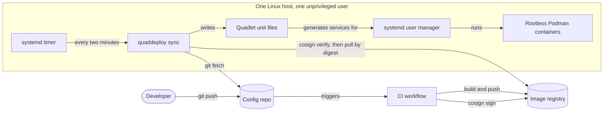
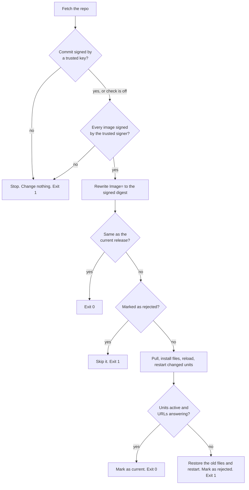

# Architecture

QuadDeploy is one command, `quaddeploy sync`, run by a systemd timer on the host it deploys to. This page explains how the parts fit and why they are shaped this way. The [README](../README.md#how-it-works) lists the steps of a run.

## The parts

Every arrow that crosses the host boundary starts on the host. Nothing outside it holds an SSH key or a deploy token for it.

## One run

## Design choices

### The host pulls

A push-based deploy needs credentials for the host stored in CI. If CI is compromised, so is the host. With a pull, the host needs only read access to a Git repo and a registry, and both can be public.

The cost is delay. A change waits for the next timer run, two minutes by default.

### Signatures are checked before anything is pulled

The agent runs `cosign verify` on each image named in the repo. If any image fails, the run stops before a single file on the host changes. There is no option to skip this.

Podman has its own signature policy, in [`policy.json`](https://github.com/containers/image/blob/main/docs/containers-policy.json.5.md). QuadDeploy does not rely on it, for three reasons.

- **It cannot name a CI pipeline as the signer.** For a keyless signature, the policy accepts only an email address as the identity. A GitHub Actions or GitLab pipeline signs with a URL, such as `https://github.com/alice/app/.github/workflows/image.yml@refs/heads/main`, and the policy has no field for that. `cosign verify` does, so the agent can require one exact workflow on one branch.
- **A per-user policy replaces the system one.** Writing `~/.config/containers/policy.json` hides the rules the distro ships in `/etc/containers`. The agent would have to take over a file that other software depends on.
- **The agent needs the digest.** `cosign verify` returns the digest that was signed, which the next step uses.

A Podman policy does work with a plain public key. If you sign with a key, it is a sound second layer, and you can add it by hand.

### Commits can be verified as well

An image signature says nothing about the unit file that runs the image, and a unit file can run any command on the host.

So the agent can also check the config repo. With `repo.allowed_signers` set, it runs `git verify-commit` on the fetched commit before checking it out, and accepts only an SSH signature from a listed key. It checks the newest commit only. That is enough, because a commit's hash covers every file and every commit below it.

The check is optional because it rules out a common workflow. Commits that GitHub creates in the browser are signed with GitHub's key, not the author's, so they fail it.

### Images are pinned to the signed digest

A tag is a pointer that the registry owner can move. Between "verify `app:main`" and "run `app:main`", the tag could point at a different image.

The agent closes that gap. It rewrites each `Image=` line to `name@sha256:...` using the digest that cosign verified, pulls by that digest, and installs the rewritten file. The host runs exactly the bytes that were signed.

Pinning also gives two things for free. A new image pushed to the same tag changes the rewritten file, so it triggers a deploy. And a rollback restores the old file, which names the old digest, so the image rolls back with the config.

### A release is identified by its content

The release id is a hash of the pinned unit files. It does not include the Git commit.

This makes "is anything different?" a single comparison. A commit that only touches the README produces the same id and deploys nothing. A reverted commit produces the id of the release it reverts to.

### Health decides, not the restart

`systemctl restart` returns success when the process starts. A container that crashes one second later still counts as started.

So the agent waits after applying a release. Each container unit must report `active` on two checks in a row, and each configured URL must answer with a 2xx status. If that does not happen before the timeout, the agent restores the previous release and then waits for that one to be healthy too.

### A failed release is not retried

After a rollback the repo still describes the failed release. Without a guard, the next timer run would deploy it again, fail again, and restart the service every two minutes.

The agent records the id of the failed release and skips it. A new commit or a new image produces a different id and is tried normally. `quaddeploy sync --force` retries the same one.

### The agent only touches files it installed

Unit files are installed flat into the user's Quadlet folder, beside any the operator wrote by hand. The agent keeps a list of the files in each release. It refuses to overwrite a file that is not on its list, and it removes only files that are.

### Both tools read one credentials file

For a private image, cosign must read the signature and Podman must pull the image. They look for registry credentials in different places. Tested with cosign 3.1 and Podman 5.8:

| Credentials saved by | cosign | Podman | Kept after a reboot |
|---|---|---|---|
| `podman login` | Reads them | Reads them | No |
| `podman login --authfile ~/.config/containers/auth.json` | Does not | Reads them | Yes |
| The `REGISTRY_AUTH_FILE` variable, pointing at any file | Reads them | Reads them | Yes |

The first row works until the host restarts. The second fails at the signature check. So the agent takes one file from `registry.authfile` and sets `REGISTRY_AUTH_FILE` for every command it runs.

### Failure is visible in systemd

`sync` exits non-zero when it fails, rolls back or skips a rejected release. The timer's service then shows as failed, so `systemctl --user status quaddeploy` and any existing unit monitoring report it. The agent can also post to a webhook. It compares each run's result with the last one and reports only a change: a new failure, a rollback or a recovery. Without that comparison, a rejected release would send a message every two minutes. A webhook that is down is logged and otherwise ignored, so alerting can never break a deploy.

## State on the host

| Path | Content |
|---|---|
| `~/.config/quaddeploy/config.toml` | Repo, trusted signer and health settings |
| `~/.config/containers/systemd/` | The installed unit files, read by Quadlet |
| `~/.local/state/quaddeploy/repo/` | Clone of the config repo |
| `~/.local/state/quaddeploy/releases/<id>/` | The pinned unit files of one release, with a manifest |
| `~/.local/state/quaddeploy/current` | Id of the deployed release |
| `~/.local/state/quaddeploy/previous` | Id of the release before it, used by `rollback` |
| `~/.local/state/quaddeploy/rejected` | Id of the release that last failed |
| `~/.local/state/quaddeploy/status.json` | Result of the last run |

Files are written to a temporary name and then renamed, so a crash cannot leave a half-written unit file.

## Code

The agent is Python with no runtime dependencies. It calls `git`, `cosign`, `podman` and `systemctl` as subprocesses through one function, which the unit tests replace with a fake. [AGENTS.md](../AGENTS.md) maps each module to its job.

## Tests

- **Unit tests** cover each module and every failure path with the fake runner. They need no Podman or systemd.
- **The integration test** in `tests/integration` runs the real agent against real Git, Podman, systemd and cosign, with a local registry and a throwaway signing key. It checks a deploy, a new image behind the same tag, an unsigned image, an unhealthy release and a manual rollback. CI runs it on every push.
