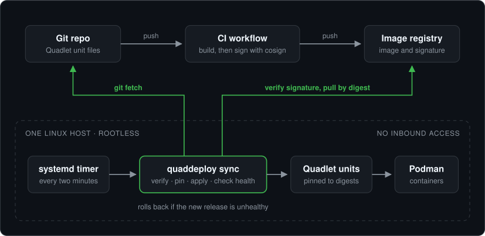
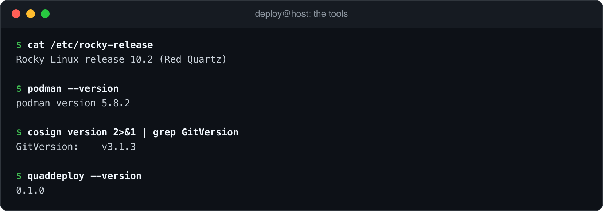
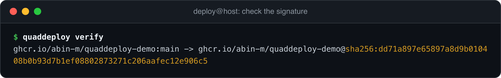
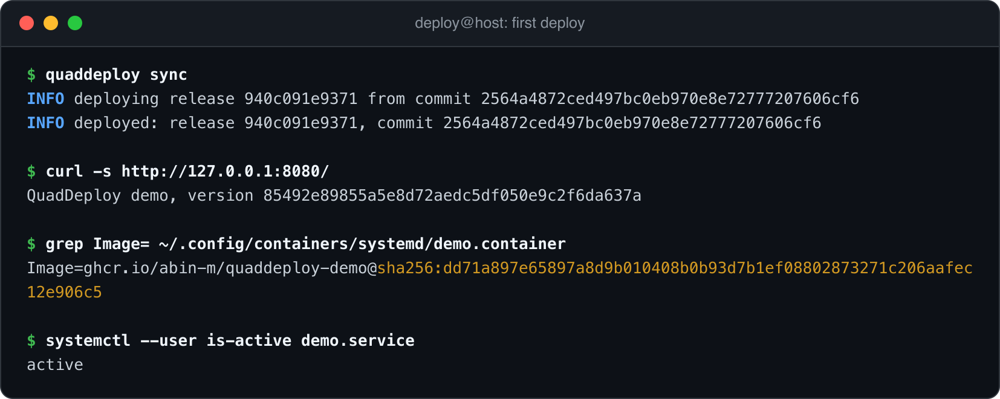
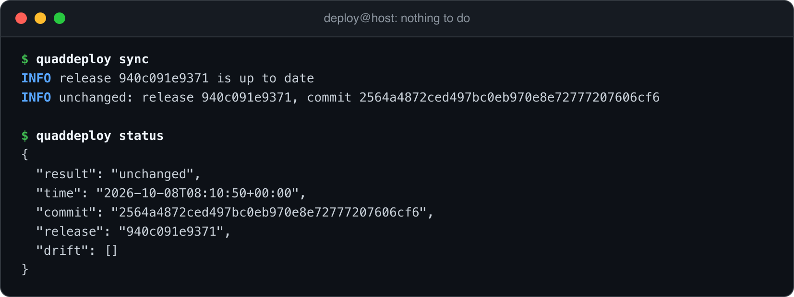
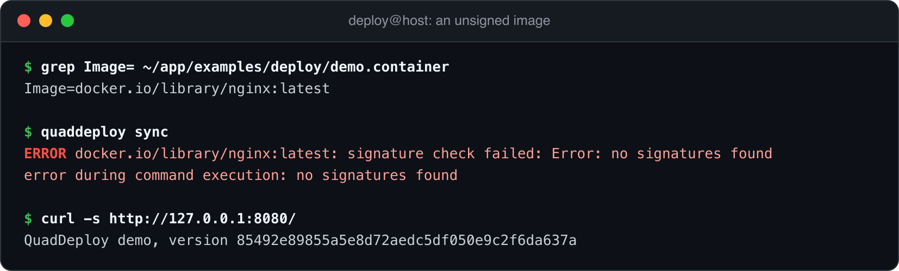
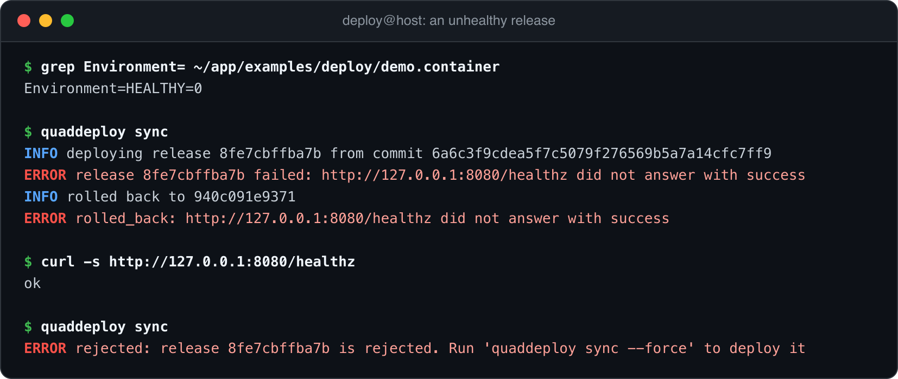
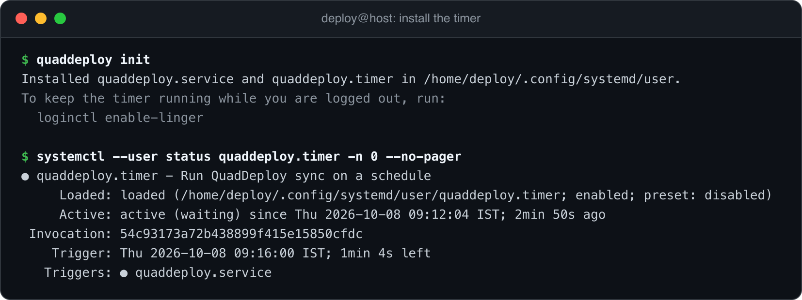
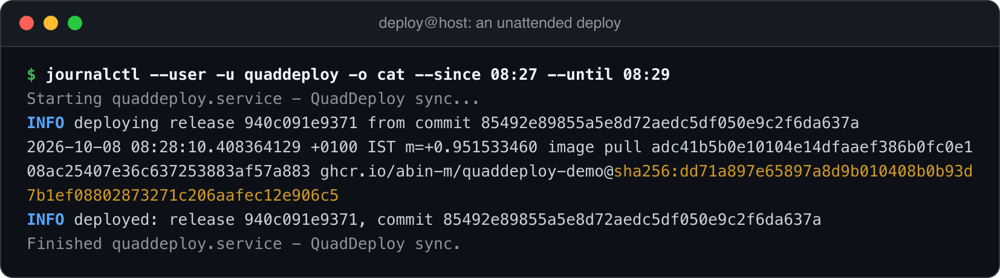

# Walkthrough

This page follows QuadDeploy through each stage on a real host: a Rocky Linux 10.2 virtual machine on arm64.

The images are rendered from the commands and output captured on that host. The output is unedited, apart from the home folder, which is shown as `/home/deploy`. Long lines wrap as they would in a terminal.

<p align="center"></p>

## 1. The host

The agent needs four tools on the host: Git, Podman, cosign and itself.

<p align="center"></p>

The config names the repo to follow and the one signer to trust. Here that signer is the `image.yml` workflow on the `main` branch of this repo.

```toml
[repo]
url = "https://github.com/abin-m/quaddeploy.git"
branch = "main"
path = "examples/deploy"

[verify]
certificate_identity = "https://github.com/abin-m/quaddeploy/.github/workflows/image.yml@refs/heads/main"
certificate_oidc_issuer = "https://token.actions.githubusercontent.com"

[health]
timeout = 60
interval = 2
urls = ["http://127.0.0.1:8080/healthz"]
```

## 2. Check the signature

`verify` runs the first half of a deploy and stops. It fetches the repo, checks each image with cosign and prints the digest that was signed.

<p align="center"></p>

The repo asks for the tag `main`. From here on, the agent uses only the digest on the right.

## 3. Deploy

`sync` installs the unit file, starts the service and waits for the health check.

<p align="center"></p>

The third command shows the point of pinning. The repo's unit file says `Image=ghcr.io/abin-m/quaddeploy-demo:main`. The file on the host names the exact image that was verified.

## 4. Nothing to do

A second run finds the same release and changes nothing. This is what the timer does on most runs.

<p align="center"></p>

`drift` lists unit files that were edited by hand on the host. It is empty here.

## 5. An unsigned image

Someone changes the unit file to an image that the trusted signer never signed. For this stage and the next, the agent followed a local clone at `~/app`, so that no broken commit reached the public repo.

<p align="center"></p>

The run stops at verification. The image is never pulled, no file on the host changes, and the app keeps serving the last good release.

## 6. An unhealthy release

This release is signed, so it passes verification. It sets `HEALTHY=0`, which makes the demo app's health endpoint fail.

<p align="center"></p>

The container starts, so `systemctl restart` reports success. The health check is what catches it. After the timeout, the agent restores the previous unit file, restarts the service and confirms that it is healthy again.

The last command is the next timer run. The repo still describes the failed release, and the agent refuses to try it again. A new commit or `quaddeploy sync --force` clears that.

## 7. Turn on the timer

`init` installs a systemd user timer. `loginctl enable-linger` keeps it running when nobody is logged in.

<p align="center"></p>

## 8. An unattended deploy

With the timer on, a `git push` is the whole deploy. This is the journal from one: a commit changed the demo app, CI built and signed a new image, and the next timer run picked it up.

<p align="center"></p>

About 170 seconds passed between the push and the new version serving. Most of that was the CI build.

## What the automated test covers

The [integration test](../tests/integration/test_e2e.py) repeats stages 3 to 6 and a manual rollback on every push, against real Git, Podman, systemd and cosign. See [architecture](architecture.md#tests).
